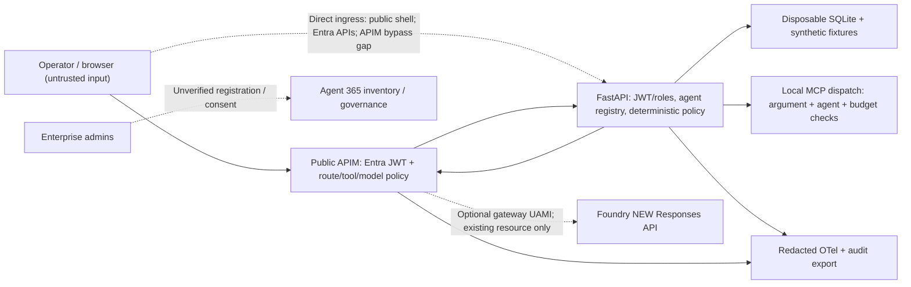

# Pernova demo threat model

Scope: loopback synthetic demo plus **undeployed** Azure template. Review before
adding a real MCP/KB/model connector or widening ingress. No real transaction,
tenant identity, SAP, Teams or data feed is assumed connected.

Assets: approved scenario and stock floors, workflow state/approval, identity and
agent/tool mapping, model/tool budget, source provenance, trace/audit integrity,
credentials and data confidentiality. Trust boundaries: browser→gateway,
gateway→app, agent/model→tool, source→retrieval, app→state/telemetry and admin→tenant.

| Threat (STRIDE / AI abuse) | Mitigation in local contract or template | Residual / required verification |
| --- | --- | --- |
| Spoofed caller/agent via headers, tool args or prompt | Entra JWT in template; backend context server-side; strip headers | Connected backend JWT + endpoint/object auth; direct ingress remains |
| Confused deputy / cross-agent tool privilege | Per-client APIM tool map and backend per-agent allowlist | One backend UAMI cannot represent isolated agent identities unless separate trusted contexts/identities are implemented |
| Approval tampering, race or stale policy | Scenario/revision-bound decision; deterministic recheck + idempotency | Real shared database transaction/unique constraint and concurrent tests; SQLite demo no distributed guarantees |
| Repudiation / altered audit exports | Same trace for denial/approval/execution; owner/revision metadata | Local export is editable; append-only restricted enterprise storage and trusted time required |
| KB/telemetry information disclosure | Synthetic-only corpus, bounded retrieval; zero APIM body logging | No real source ACLs; audit exports/OTel attributes must be redacted; identifiers may still need classification |
| Tool loop, huge input, token/cost DoS | Application budgets; APIM call/token limits and MCP/Responses JSON caps | Completion/concurrency overshoot, repeated control workflow requests and telemetry costs; real quotas/alerts needed |
| Unapproved model/remote MCP exfiltration | Exact deployment allowlist; no provider-side tools in bounded Responses policy | Validate egress/private endpoints; text can still contain sensitive data; general DLP not supplied |
| Indirect prompt injection in source/tool result | Treat as data; policy/stock/cost/approval never LLM-authorized | Fixture rejection is not comprehensive prompt-shield evaluation |
| Supply-chain compromise | Protected feeds, locks, SHA-pinned CI, owner review | Scan image/dependencies, SBOM/provenance, attest artifact, patch monthly; verify repo settings |
| Overprivileged tenant registration | No grants/login/provisioning during implementation | Separate admin approval, PIM/least privilege, sponsor and quarterly review for Agent 365/IAM |
| Recovery resumes unsafe operation | Stop agent, invalidate approval, replay only idempotently | Persisted enterprise suspension and reliable propagation; no native Agent 365 application shutdown claim |

## Security release gates

Connected release is blocked until authenticated caller-to-agent mapping,
endpoint and object authorization, spoofed-header denial, concurrent budget and
approval replay tests pass. Production is additionally blocked by direct-ingress
bypass, ephemeral state, missing source ACLs, unverified redaction/retention,
tenant access and DR/on-call readiness. Security owner signs residual risk, not
the LLM. See [gateway negative tests](gateway-controls.md) and [runbook](operations-runbook.md).
